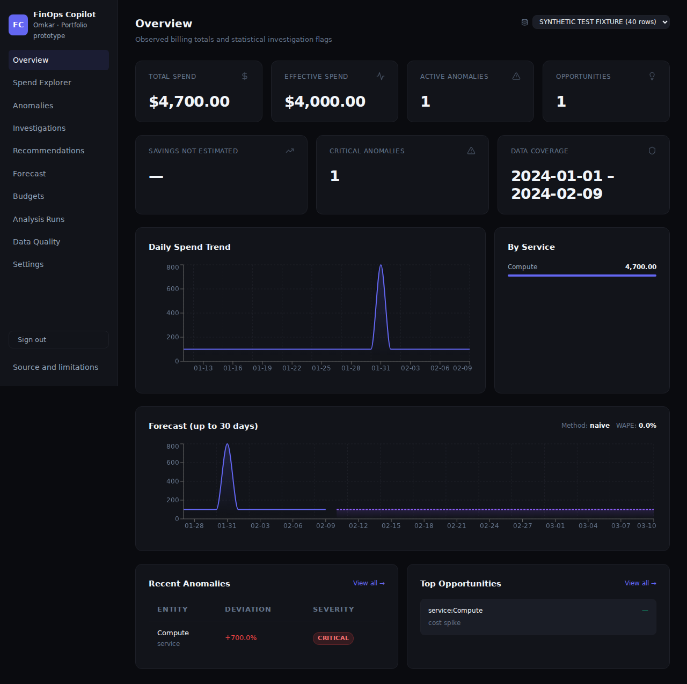
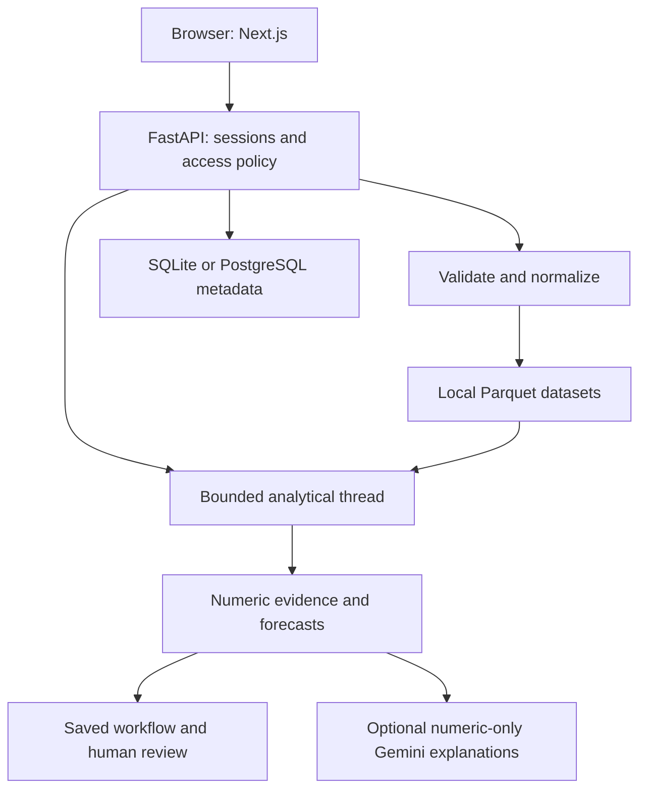

# FinOps Copilot

A portfolio prototype for investigating FOCUS-formatted cloud billing exports. Python computes billing totals, statistical flags and forecasts; optional Gemini calls explain aggregate numeric evidence.

**Maintainer:** [Omkar](https://github.com/omkark2404) · [Repository](https://github.com/omkark2404/finops-copilot)



The screenshot uses a **SYNTHETIC TEST FIXTURE**, not customer data. It demonstrates the UI, not forecast accuracy or realized savings.

## What works

- CSV/Parquet ingestion with SHA-256 provenance, per-owner duplicate detection, row/byte limits and quality rejection.
- Single-currency spend exploration with bound SQL, UTC dates, exact decimal aggregation and service-only HHI.
- Causal anomaly flags and recursive forecasting with naive/moving-average baselines, Holt-Winters and eligible LightGBM candidates.
- A seven-stage evidence workflow, saved runs, optional numeric-only external narratives, and a deterministic review checklist.
- Persisted human review and explicitly assumed whole-dataset scenarios. The app never changes cloud infrastructure.
- Per-owner dataset/budget access; administrators can access all records. Viewer/executive roles cannot mutate data.
- HTTP-only session cookies, CSRF checks, request rates, migrations and CI checks.

This is **not a production certification, full FOCUS conformance validator, autonomous agent system, or zero-hallucination guarantee**. Read [limitations](docs/LIMITATIONS.md) and [data semantics](docs/DATA.md).

## Architecture



Analytical work is serialized per API process with a bounded waiting period. There is no disconnected Redis/ARQ queue, embedded shared DuckDB database file, or advertised multi-node scaling.

## Run locally

Requires **Python 3.12**, **Node.js 22+**, npm and Git.

```bash
git clone https://github.com/omkark2404/finops-copilot.git
cd finops-copilot
./start-local.sh
```

On first run, the script creates a private local `.env` with random admin/JWT secrets and installs locked dependencies. It never sources `.env` as shell code. Read `ADMIN_EMAIL` and `ADMIN_PASSWORD` from your local file to sign in; no shared admin password is published. Frontend: http://localhost:3000, backend: http://localhost:8000, OpenAPI: http://localhost:8000/docs.

### Manual setup

From the repository root:

```bash
python3.12 scripts/init_env.py
python3.12 -m venv backend/.venv
backend/.venv/bin/pip install -r backend/requirements.txt
```

Terminal 1:

```bash
cd backend
.venv/bin/python -m app.migrate
.venv/bin/uvicorn app.main:app --host 127.0.0.1 --port 8000
```

Terminal 2, from the repository root:

```bash
cd frontend
npm ci
npm run dev
```

SQLite is the explicit local default. Set `USE_LOCAL_SQLITE=false` and PostgreSQL credentials or `DATABASE_URL_OVERRIDE` for PostgreSQL. Storage paths, including SQLite, resolve under `DATA_DIR`. Back up existing metadata and Parquet together before upgrading; startup applies Alembic migrations.

### Docker Compose

```bash
python3.12 scripts/init_env.py
docker compose up --build
```

Compose uses PostgreSQL and named volumes, does not publish database ports, and runs application images as non-root users. The browser still uses localhost:8000. See [deployment](docs/DEPLOYMENT.md) before configuring a remote site.

## Demonstrate the workflow

1. Sign in with your private local credentials.
2. Upload a billing CSV/Parquet in Settings; supported fields and limits are in [DATA](docs/DATA.md).
3. Select the dataset and inspect spend, data quality and anomaly flags.
4. Run the evidence workflow and revisit the persisted result.
5. Review recommendations. Recording approval does not execute an action.
6. Enter your own reduction percentage to simulate its effect on **all observed dataset spend**. Scenarios overlap and must not be added together.
7. Delete the dataset to remove its metadata, related runs and analytical files.

Errors are displayed distinctly from empty results. A missing forecast is not a zero forecast. Currency comes from the data. The former MoM field now represents equal-length adjacent selected windows; it is unavailable without preceding coverage.

## Evaluation and tests

No previous benchmark, financial impact, user count or predictive-accuracy claim is retained without reproducible evidence. See [evaluation](docs/EVALUATION.md) for the pinned public billing sample and runner. Its totals reconcile, but six-day forecast WAPE is 80.1% and MAE does not improve on the naive baseline; predictive quality remains unproven.

```bash
# From repository root
backend/.venv/bin/pip install -r backend/requirements-dev.txt
(cd backend && .venv/bin/pytest tests/ -q)
backend/.venv/bin/ruff check backend/app backend/tests backend/migrations
backend/.venv/bin/ruff format --check backend/app backend/tests backend/migrations
(cd frontend && npm run lint && npm run typecheck && npm run build)
(cd frontend && npx playwright install chromium && npm test)
```

Browser tests start a separate local backend and frontend and use synthetic data only. Type/lint errors are not bypassed. Dependency locks are generated from `backend/requirements*.in` and npm manifests; upgrade with a reviewed diff and rerun audits.

## Privacy and scope

Raw uploads are deleted after ingestion; normalized billing files persist until deletion. Offline mode is the default. With a configured Gemini key, only numeric/bool aggregate evidence is sent externally; uploaded names/IDs/text are excluded. Narratives are untrusted, numerical grounding is checked conservatively, and failures/budgets produce visible degraded output. Token counts and latency are recorded; monetary LLM cost still requires provider billing reconciliation.

No utilization telemetry, tagging allocation, commitment purchasing, realized-savings reconciliation, distributed compute or production tenancy certification is implemented. Forecast intervals and empirical anomaly precision/recall are not established. Missing billing days are rejected by forecasting rather than silently filled.

## Ownership, licensing and provenance

Current maintenance belongs to **Omkar / omkark2404**. Historical source provenance and original licensing remain unverified; [PROVENANCE](docs/PROVENANCE.md) records the observable history without assigning unproven authorship. [LICENSE-STATUS](LICENSE-STATUS.md) replaces the unsupported MIT claim. Preserve all applicable third-party credits in [THIRD_PARTY](docs/THIRD_PARTY.md).

## Next work

Validate predictive quality on licensed, representative billing histories; add persistent object storage and asynchronous jobs only when a measured workload justifies them. See [remediation status](docs/REMEDIATION.md) for remaining external verification.
